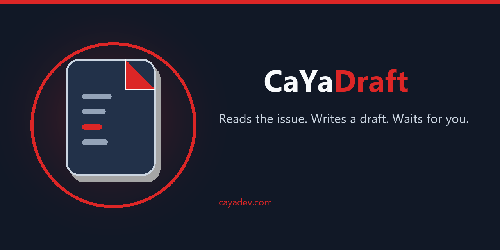

# CaYaDraft



Local GitHub bot for one owner. When an issue opens, CaYaDraft thanks the author, summarizes the title and body in English with a local [Ollama](https://ollama.com) model (`qwen3.5:4b`, thinking disabled), then mentions the account that installed the app and stops.

It does not edit the repository until that account asks. A fix becomes a pull request. The bot never merges and never runs the project's scripts or tests.

Cloning this repository does not give you a running bot. You create your own GitHub App, your own webhook secret, and your own Ollama model. Nothing here calls home.

## What you get

1. An issue is opened on a repository where your app is installed.
2. The first comment thanks the author, then gives a request, an analysis, and a suggested draft for everyone.
3. The last line mentions the installing account and says the bot will not change code until that account asks.
4. Later comments get a reply only when they include `@cayadraft` or `@cayadraft[bot]`. GitHub's mention menu does not list a GitHub App, so the name has to be typed.
5. Only the installing account can run a command. Other people are ignored.
6. `/caya fix` opens a pull request. `@cayadraft` followed by your own sentence can choose a tool: read the issue, open a pull request, or add a commit on the current one.
7. On that pull request you can revise or revert. Merging is yours.

Replies are in English, including when the issue is Turkish. Turkish aliases such as `/caya düzelt` and `/caya geri son` work.

An attached image is not read. The comment quotes the title and the written text and says the image was not read.

## Commands

Write a new comment. A comment that contains the hidden marker `<!-- cayadraft -->` is ignored, so the bot does not answer itself.

| Command | Effect |
| --- | --- |
| `/caya help` | Command list |
| `/caya analyze` | Read the issue again |
| `/caya summarize` | Short summary |
| `/caya checklist` | Checklist |
| `/caya draft` | Suggested next step, no code change |
| `/caya reply` | A reply you can copy |
| `/caya ask <question>` | Answer from the issue text only |
| `/caya translate en` or `/caya translate tr` | Translate the issue |
| `/caya labels` | Suggest labels that already exist |
| `/caya labels apply` | Add those labels. Unknown names are skipped |
| `/caya title` | Suggest a title |
| `/caya title apply New title` | Rename the issue |
| `/caya plan` | Show a small edit and wait |
| `/caya fix` | Open a pull request |
| `/caya fix <instruction>` | Open a pull request from your instruction |
| `/caya wait` | Stay idle |
| `@cayadraft <instruction>` | Free-form request. The model picks the tools |

On the pull request:

| Command | Effect |
| --- | --- |
| `/caya explain` | Describe the current diff |
| `/caya revise <instruction>` | Another commit on the same branch |
| `/caya revert last` | Undo the latest CaYaDraft commit |
| `/caya revert` | Make the branch match the base branch again |

`/caya revert last` on a revert commit undoes that revert. Nothing is force-pushed. The pull request body does not contain `Closes #n`, so merging does not close the issue unless you add that line.

## Limits

A normal fix stays within 5 files and 8 replacements. Past `MAX_DIFF_LINES` (300 by default) the pull request still opens and the comment adds a review warning. The bot can add a missing text file. It refuses `.env`, private keys, and other secret-looking names. It does not send the issue to a cloud model.

## Install your own

You need Python 3.11+, Git, and Ollama on the same machine. The GitHub App, the private key, and `WEBHOOK_SECRET` are yours. Do not commit them. `.env` and `*.pem` are gitignored.

```powershell
git clone https://github.com/CaYatur/CaYaDraft.git
cd CaYaDraft
python -m venv .venv
.\.venv\Scripts\Activate.ps1
pip install -r requirements.txt
ollama pull qwen3.5:4b
copy .env.example .env
```

On macOS or Linux, use `python3 -m venv .venv`, `source .venv/bin/activate`, and `cp .env.example .env`.

Edit `.env`:

- `OWNER_LOGIN` and `MENTION_LOGIN` are a fallback. The account that installs the app is the one who can run commands and the one who is mentioned.
- `OLLAMA_MODEL` stays `qwen3.5:4b` unless you pull a different local model.
- `WEBHOOK_SECRET` is a long random string. The GitHub App must use the same string.
- `HOST` stays `127.0.0.1`. Put a reverse proxy in front of it.
- `PORT` is the local port, `8787` by default.
- `PUBLIC_URL` is the public address of that proxy, without a trailing slash.
- `REPO_ALLOWLIST` is optional. A comma-separated list such as `your-login/your-repo` ignores every other repository. Leave it empty to accept every repository where the app is installed.
- `GITHUB_APP_ID` is the App ID from the app's settings page. `GITHUB_PRIVATE_KEY_PATH` points at the `.pem` file on that machine.
- Leave `GITHUB_TOKEN` empty when the app is set. A token makes comments appear as that user instead of the app.
- `GIT_AUTHOR_EMAIL` is for local git only. Commits made through the GitHub API use the app's own identity.

Check it before you open the port:

```powershell
python -m cayadraft doctor
python -m cayadraft preview --title "Typo in the readme" --body "Please change the button label to Save."
```

`doctor` checks Git, Ollama, and the GitHub settings. `preview` prints a first comment on your machine and does not post it.

### GitHub App

Create the app on the account that will use it: **Settings → Developer settings → GitHub Apps → New GitHub App**.

- Name: your choice. The comment mention is `@` plus the app's slug, for example `@cayadraft`.
- Homepage: any page you control.
- Webhook URL: `https://your-host.example/cayadraft/webhook` (your `PUBLIC_URL` plus `/webhook`).
- Webhook secret: the same value as `WEBHOOK_SECRET`.
- Repository permissions: Contents **Read and write**, Issues **Read and write**, Pull requests **Read and write**. Metadata stays read-only.
- Subscribe to: Issues, Issue comments, Pull requests, Pull request review comments.
- Installation: **Only on this account**. Do not offer the app to every GitHub user. Their issues would be delivered to your computer.

Generate a private key and save it next to the project, or anywhere outside git, and set `GITHUB_PRIVATE_KEY_PATH`. Install the app on the repositories you want. If GitHub asks you to accept new permissions later, accept them on that installation. Contents write is what lets the app commit. `assets/avatar.png` can be the app logo.

Start the process:

```powershell
python -m cayadraft
```

On Windows, `cayadraft.bat` does the same thing with `.venv` when that folder exists.

### Public address

GitHub cannot call `127.0.0.1`. The process listens on localhost. Your proxy forwards the public path to `127.0.0.1:8787` and keeps the signature headers: `X-Hub-Signature-256`, `X-GitHub-Event`, and `X-GitHub-Delivery`.

The app accepts `POST /webhook`, `POST` under `PUBLIC_PREFIX`, and `POST /` when the proxy removes the prefix. A health check is `/health` on the same path.

Caddy:

```
handle /cayadraft* {
    reverse_proxy 127.0.0.1:8787
}
```

nginx, keeping the prefix:

```
location /cayadraft {
    proxy_pass http://127.0.0.1:8787;
    proxy_set_header Host $host;
    proxy_set_header X-Forwarded-Proto $scheme;
    proxy_set_header X-Hub-Signature-256 $http_x_hub_signature_256;
    proxy_set_header X-GitHub-Event $http_x_github_event;
    proxy_set_header X-GitHub-Delivery $http_x_github_delivery;
}
```

Do not add a trailing slash to `proxy_pass` if you want the prefix kept. A slash strips it. `POST /` still works in that case.

### Without a public address

`python -m cayadraft poll --repo your-login/your-repo` reads that one repository through the API. It is a fallback for a machine GitHub cannot reach. The webhook is the setup to leave running.

### Token fallback

`GITHUB_TOKEN` works if `GITHUB_APP_ID` is empty. Use a fine-grained token with Issues, Pull requests, and Contents read and write. Comments then appear as the token owner. Prefer the GitHub App. Do not commit the token or the `.pem` file.

## Try it

Open an issue on a repository in `REPO_ALLOWLIST`, or on any repository where the app is installed if the list is empty. You should see one English comment. Then, from the installing account, comment:

```
/caya fix README.md add a short project description at the end
```

Review the pull request yourself. The bot will not merge it.

## Checks

```powershell
python -m unittest discover -s tests -t . -v
```

Regenerate the images with `pip install pillow` and `python scripts/render_brand.py`.

## License

MIT. See [LICENSE](LICENSE).
